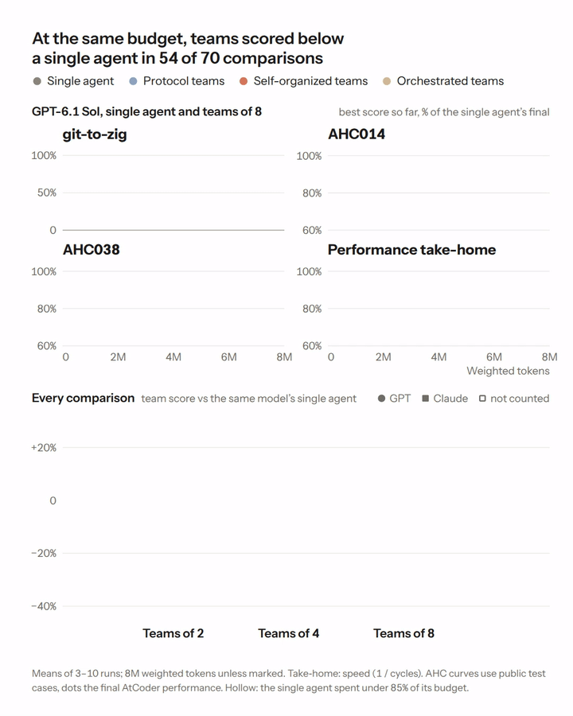

# Raising the roof

Code and data for the Paradigm 3 post *Swarms do not yet raise the roof*.

Does adding agents to a team raise the ceiling of what they can do, or is it a fast but less efficient way to spend
more tokens? We compared teams of 2, 4 and 8 agents with a single agent given the same total budget of weighted
tokens, on four long tasks:

| Task | Source | Score |
|---|---|---|
| git-to-zig: reimplement git in Zig | [FrontierSWE v2](https://github.com/Proximal-Labs/frontier-swe-v2) | share of git's 743 test scripts passed |
| AHC014 "RectJoin" | [ALE-Bench](https://github.com/SakanaAI/ALE-Bench) | AtCoder performance on 2,000 hidden cases |
| AHC038 "Tree Robot Arm" | [ALE-Bench](https://github.com/SakanaAI/ALE-Bench) | AtCoder performance on 2,000 hidden cases |
| Performance take-home | [Anthropic](https://github.com/anthropics/original_performance_takehome) | clock cycles (lower is better) |

The teams were organized in three ways:

| Setup | How the team works |
|---|---|
| Protocol teams | Park et al.'s prompt gives each agent its own approach and rules for sharing findings in shared files |
| Self-organized teams | The agents decide how to split the work. GPT teams talk on Codex's hidden message board, Claude teams through Claude Code's direct messages, and mixed teams through SwarmChat |
| Orchestrated teams | Codex's Ultra mode: one orchestrator starts helpers and hands out the work, on one shared budget |

The budget counts output tokens in full, uncached input tokens at a quarter and cached input tokens at 2%,
following CAISI's evaluation of DeepSeek models. A team splits it evenly between its agents and is scored on the
best submission of any of them.



Teams of 8 spent the budget about 6 times sooner than the single agent and scored about 7% lower. In 54 of 70
comparisons, a team scored below the single agent with the same budget.

The one place where teams pulled ahead was git-to-zig at 32M weighted tokens, with GPT-6.1's self-organized teams.
There, a single agent that splits its budget into 8 fresh sessions run one after another did better again:

| git-to-zig, 32M weighted tokens | GPT-6.1 Sol | GPT-6.1 Terra |
|---|---|---|
| Single agent, one long session | 83.7% | 26.6% |
| Self-organized team of 8 | 93.2% | 32.0% |
| Restarted single agent, 8 sessions in a row | 97.0% | 41.9% |

## What's here

| Path | |
|---|---|
| `run.py`, `agent.py` and the modules next to them | the harness. How to run it: [`docs/harness.md`](docs/harness.md) |
| [`docs/`](docs/) | the [setups](docs/setups.md), the [tasks](docs/tasks.md), the [command behind each kind of run](docs/experiments.md), [BrowseComp](docs/browsecomp.md) and the [Codex patch](docs/codex-patch.md) |
| [`data/`](data/) | one row per run: score, tokens, time and flags ([`data/README.md`](data/README.md)) |
| [`analysis/`](analysis/) | the scripts behind every number and chart in the post ([`analysis/README.md`](analysis/README.md)) |
| [`site/`](site/) | the results explorer: every configuration and every run, grouped by question |
| [`benchmarks/`](benchmarks/) | what goes into each task's containers: tools, judges and scorers |
| [`codex-patch/`](codex-patch/) | the fix for a Codex compaction bug that some runs used |
| [`tests/`](tests/) | the harness's tests |

To check the post's numbers (Python 3.11+, no packages needed):

```
python3 analysis/headline.py
```

To build the results explorer, run `python3 site/build.py` and open `site/out/index.html`.

The harness needs Linux, Docker and [uv](https://docs.astral.sh/uv/). It runs Claude Code and Codex agents signed
in with your own subscription or API key. Start with [`docs/harness.md`](docs/harness.md).

Transcripts and run folders are not in this repo.

## Credits

- Park et al. (2026), [Scaling Discovery through Test-Time Communication](https://arxiv.org/abs/2609.21032). This
  repo started from their harness
  ([jerryjonghopark/test-time-communication](https://github.com/jerryjonghopark/test-time-communication)), and the
  first commit in `git log` is theirs. Protocol teams use their prompt.
- The tasks: [FrontierSWE v2](https://github.com/Proximal-Labs/frontier-swe-v2) (Proximal Labs),
  [ALE-Bench](https://github.com/SakanaAI/ALE-Bench) (Sakana AI), Anthropic's
  [original performance take-home](https://github.com/anthropics/original_performance_takehome), and OpenAI's
  BrowseComp with the grader from [simple-evals](https://github.com/openai/simple-evals)
  ([`benchmarks/browsecomp/NOTICE.md`](benchmarks/browsecomp/NOTICE.md)). The harness fetches each task's own
  code when a run starts.
- [Harbor](https://github.com/laude-institute/harbor), which runs each task's containers.
- [Codex](https://github.com/openai/codex) (its message board and Ultra mode) and
  [Claude Code](https://code.claude.com).
- [SwarmChat](https://github.com/Pranjal2041/swarmchat), copied unchanged into [`vendor/swarmchat/`](vendor/swarmchat/)
  (MIT).
- Toby Ord's [analysis of swarm scaling](https://www.tobyord.com/writing/swarm-scaling), whose λ the post measures.

The code is MIT-licensed ([`LICENSE`](LICENSE)).
